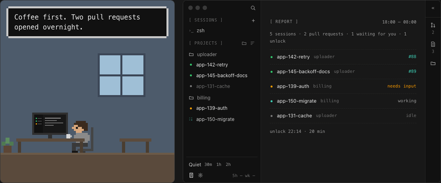

<h1 align="center">Curfew</h1>
<h3 align="center">Agents work late. You don't.</h3>
<p align="center">
  A herdr layout for running coding agents side by side, each in its own git worktree, that goes quiet at night so you can log off while they work.
  <br />
  <a href="#install">Install</a>
  ·
  <a href="docs/reference.md">Reference</a>
  ·
  <a href="https://github.com/rquellh/herdr-quiet-hours">Quiet hours on its own</a>
</p>

<p align="center"></p>

## About

Curfew turns herdr into a calm place to run coding agents in parallel. The sidebar lists your
sessions and your projects, and a project's `+` starts a new task in its own worktree and
branch, with Claude Code or any other agent herdr knows. The pane on the right follows each
task: its pull requests and their checks, its changes, and its files. Click a file and its diff
opens as a tab, with code comments dimmed or folded out of the way. Claude Code's 5-hour and
weekly usage sits at the bottom of the sidebar.

Choose your hours, or go quiet for an hour before a meeting. Your agents keep running, and the
window becomes a dim board that shows only whether each one is working, waiting or done. You can
still look: an unlock lasts ten minutes, then quiet comes back on its own, and every unlock shows
up in the morning summary.

It works like putting your phone in a box by the door. Nothing is out of reach; reaching for it
is a decision now, not a reflex.

## Install

In herdr, ask your agent:

> Add herdr.dev/layouts/rquellh/herdr-curfew, with its themes folder.

Or by hand, from a clone of this repo:

```sh
H=~/.config/herdr-app
cp themes/curfew.json "$H/themes/"
cp layouts/curfew.json layouts/curfew.svg "$H/layouts/"
mkdir "$H/.incoming" && cp -R mods/* "$H/.incoming/" && mv "$H/.incoming"/* "$H/mods/" && rmdir "$H/.incoming"
herdr-app do layout.switch '{"name":"curfew"}'
```

Your own layout stays as it was, and `ctrl-shift-l` switches back. Quiet hours start switched
off: click the clock at the bottom of the sidebar to set your hours. `Quiet 30m 1h 2h` works any
time.

The [reference](docs/reference.md) covers the Claude Code launcher, new worktrees, what Curfew
runs and writes, and how to uninstall it.

## Requirements

herdr on macOS, git, and node 18 or later. For pull requests, gh, signed in. For the usage
readout, Claude Code.

## License

[Apache-2.0](LICENSE). [NOTICE](NOTICE) credits the code Curfew builds on.
