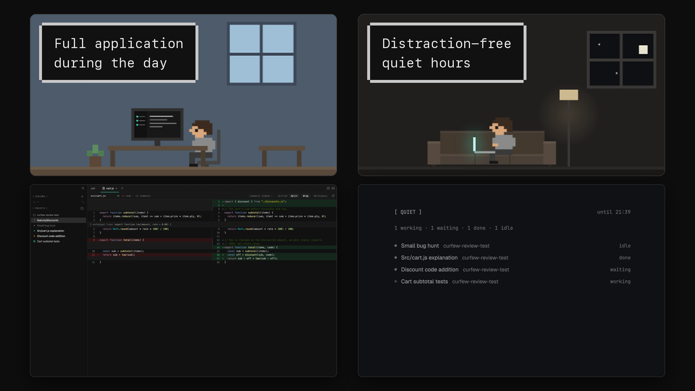

# Curfew

Run coding agents side by side, each in its own git worktree, and log off while they work: a
near-black window with a sidebar of terminals, git projects and agents, one 40 px tab row over
hairline-split terminals, and a review pane on the right that switches between the session's
pull requests, its changes and its files. Diffs open as tabs in the middle with code comments
dimmed or folded, the sidebar foot shows Claude Code's 5-hour and weekly usage, and quiet hours
swap the window for a dim board at night.

## What you see

Left to right: the sidebar (256 px), the work area (the rest), the review pane (320 px). No
system title bar: the macOS window buttons sit at `[13, 13]` over the sidebar's top strip.
Terminals are Menlo 13 px with `[6, 8]` padding; the mods' text is the system UI font
(`.SystemUIFont`) unless marked Menlo. Colors below are the theme's names; the values are in
**The theme** at the end of this section. Columns are divided by 1 px `border` lines.

- **Sidebar**, 256 px (180 to 520), on `chrome`, not resizable by drag.
  - **Title strip**, 40 px, drags the window. At its right end (10 px in) a 22 px search
    button: a 16 px magnifier in `dim`, `foreground` on a `hover` square under the pointer.
  - **The list**, 13 px text, scrolling: the TERMINALS and PROJECTS sections. Under it, outside
    the scroll, the AGENTS block (below), so the agents stay in view however long the list gets.
    - **A section head**, a 30 px bar the sidebar's full width (the rows under it keep a 6 px
      inset), 14 px padding at the left and 11 px at the right, 6 px gaps, a 1 px `border` line
      along its top: TERMINALS's at the top of the list, PROJECTS's 8 px below what's above; the
      AGENTS head has none (its block's line is the rule). Its name at the
      left in Menlo 10 px medium `#c9c9c9`; at its right, always, its count (of spaces, projects
      or agents) in Menlo 11 px `dim`, then its button. It folds like a project's head
      (remembered), and folded, everything under it goes. Under the pointer it takes `hover`
      (square, no radius) and a 16 px chevron in `muted` (down when open, right when folded)
      comes in before the name, moving it right.
    - TERMINALS with a 22 px `+`. Under it, the spaces that aren't in any git repo.
    - PROJECTS with a folder-plus button (Add project). Under it, per git repository: a
      26 px head (2 px above it, 4 px radius) with a 16 px folder icon, the repo's name (12 px
      medium, `muted`); folded, its row count at the right in Menlo 11 px `dim`, preceded by
      `2 done ·` in `done` when its spaces finished unseen. Under the pointer the head takes
      `hover`, the folder becomes a chevron (down when open, right when folded), the name turns
      `#c9c9c9`, and a `+` and an 18 px `⋯` appear at its right (no `⋯` while the project is
      being removed). Then its spaces, the main checkout first, worktrees after it. While a new
      worktree is being made, a "preparing" row sits under its project until the space opens;
      while Remove project deletes a worktree, a row for it sits there too.
    - With no projects: `Add a git repository to start a workspace.` (12 px, `dim`).
    - **A row**, 26 px, 8 px padding, 6 px gaps, 4 px radius: a 16 px status column (below),
      then the name: a space someone named keeps its name; else the name its Claude Code
      session gave itself (the terminal title from its first prompt or `/rename`, without the
      leading `✳`/`◐`/`◑`; `Claude Code` and an empty title change nothing, so the last name
      stays after an exit; kept in shared `curfew-sidebar.titles`); else, for a session, what
      runs in it as its tab names it (the shown tab first: a tab's name if someone named it, else
      its agent's or program's: `claude`, `nvim`, `caffeinate`; a shell names nothing); else its
      branch; else herdr's name (a session's folder). A branch that isn't the name is never on
      the row, only in its tooltip (`branch <name>`); a session's tooltip is its folder. At its
      right, `↑2 ↓1`
      against its upstream, then `›_` when a program other than an agent or shell runs in
      it. The shown space's row is on `selected`, a hovered one on `hover`. Under the pointer
      the right side shows the status word instead (Menlo 11 px) and an 18 px `⋯`.
  - **The AGENTS block**, pinned under the list on `background`, a 1 px `input` line along its
    top and 6 px of padding at its bottom: the AGENTS head (no button; while agents need input
    its count reads `2 needs input · 5`, `2 needs input` in `blocked`), then an agent row
    (below) per agent herdr knows, 6 px in, at most 8 rows (208 px) before they scroll on their
    own; with none, `No agents running.` (12 px, `dim`). Folded, only its head stays.
    - **An agent row**, a row's size, padding, gaps and radius, on `hover` under the pointer:
      the status column and the name's tone as a space's (below), then the agent's name as the
      quiet board names it (its Claude Code session's name, else its tab's if someone named
      the tab, else its program: `Claude Code`, `Codex`), then its space's project in `dim`
      (the repo's name, else the folder's, `~` at home; blank until git has answered), which
      gives way first when the row is narrow. At its right, always, its word in Menlo 11 px
      `dim`: `needs input` (in `blocked`), `working`, `done` (no time), `idle`. Those that need
      input come first, then working, done, idle, each in herdr's order. Its tooltip is its
      space's row name, when that isn't the agent's own.
  - **The foot**, 66 px: the quiet-hours chip (a 30 px block), then a 36 px row: a gear
    (Settings) in a 36 px block and the usage readout filling the rest.
    - **Usage readout**, Menlo 11 px, right-aligned: `5h 42% · 2h 10m   wk 18% · 3d 4h`. Labels
      `dim`, numbers `muted` (`foreground` under the pointer, on a 22 px `hover` button with a
      2 px radius); a number is `blocked` from 80% and `#ef2929` at 100%; the time to each
      reset in `dim`. When the block is too narrow, the times go first (a window at 100%
      keeps its own longest), then the numbers stand alone.
      `5h — wk —` in `dim` before any reading; a window whose reset has passed shows `—`. On
      a plan with no 5-hour limit Claude Code sends no such window and it reads `5h ∞`.
    - **Quiet chip**: `Quiet 30m 1h 2h` at the left (`Quiet` 12.5 px `muted`; the lengths
      Menlo 11 px, `1h` `muted`, the others `dim`), herdr's clock icon and when quiet next
      starts (`18:00`, `mon 18:00`, `off`) at the right in Menlo 11 px `dim`. While unlocked:
      an `accent` open lock, `9:52 left` ticking, `lock now`.
- **Work area**, on `background`.
  - **Tab row**, 40 px, drags the window, on `background` with a dashed 1 px `border` line
    along its bottom (6 px on, 6 px off). The shown space's tabs, 2 px apart, scrolling
    sideways: 13 px, 8 px padding, the name at most 180 px. A tab reads what runs in it: its
    name if someone named it, else its agent (`claude`), else the focused program, a shell as
    your shell's name (`zsh`). The active tab is `foreground` with a 2 px `accent` line along
    its bottom; a hovered one `#c9c9c9`; others `muted`. After the name, a 5 px dot in the tone
    of `working`, `blocked` or `done` when its agent is in that state, then `×` (hidden; at
    half strength on the active or hovered tab; full under the pointer). A diff tab has a
    14 px icon before its name: a page with ± for a file, the branch-merge mark for a pull
    request's (`#123 …`). Then `+` (22 px, 4 px after the last tab). At the right end, 22 px
    buttons: split beside and split below. With the sidebar hidden, the row starts after the
    window buttons.
  - **Panes**: the shown tab's terminals, square, 1 px apart on `border` (the gaps read as
    hairlines). In a split tab, the pane with the keyboard has a 1 px `accent` line along its
    top; the others' top line is `background`. A single pane has no line.
  - **Diff tabs**: a tab whose only pane is the diff, one file per tab. A toolbar across the
    top: the file's path, `+a −d` (`done` and `#ef2929`), `Unified | Split`, `Wrap`,
    `Whitespace`, the comment-line mode (`Comments dimmed ▾`: Dim (the default), Show (as
    code), Fold (one row per run of comment lines), remembered per project), and on a pull
    request's diff the review-thread controls (show or hide the threads, or only the hunks
    that have them). Below, the hunks in Menlo with line numbers, syntax colors, the changed
    words of a changed pair marked, and a pull request's review threads under their lines,
    each folding at its head. Changed lines that are only a code comment are drawn at half
    strength in Dim, as code in Show, folded to one row per run in Fold. Read-only.
- **Review pane**, 320 px (240 to 520), on `chrome`.
  - **Strip**, 40 px, drags the window, a 1 px `border` line along its bottom. At the left
    three views, each a 16 px icon with 8 px padding: Pull requests (followed by the count of
    open and draft pull requests), Changes (followed by the changed-file count), Files; counts
    in Menlo 11 px `dim`. The shown view is `foreground` with a 1 px `foreground` line under
    it; the others `dim`, `muted` under the pointer. At the right end `»` (Hide review).
  - **Pull requests**: a 34 px head, `PULL REQUESTS` (Menlo 10 px medium `#c9c9c9`, the tone of every head's label: the
    section heads, the review pane's, the cards' and the dialogs') then
    `3 open · 1 failing` (Menlo 11 px; `failing` in `#ef2929`) and a 22 px refresh at the right.
    Then two-line rows (10 px left, 12 px right, 8 px top and bottom, `hover` under the
    pointer): a 5 px dot, `#123` (Menlo 12 px `muted`), the title (13 px `foreground`), the
    comment count with a 12 px speech icon (`foreground` when there are new comments, else
    `dim`); under it, 20 px in, Menlo 11 px: `into main`, the checks (`✗ lint · 6/7` in
    `#ef2929`, `running 4/7` in `working`, `✓ 7/7` in `done`), `+a −d`, and `· subagent` when
    a subagent's branch made it. Open and draft ones first; merged and closed ones after a
    dashed `border` rule and `MERGED · CLOSED`, their number and title `dim`. Empty: `No
    pull requests from this session yet.` A row opens the pull request in place: `‹ #123`
    back, its title (14 px semibold), a meta line, then Changes (its files, 28 px rows with
    `A`/`M`/`R`/`D`), Checks and Comments (review state, each comment's markdown), each
    folding at its head.
  - **Changes**: `CHANGES` with `+a −d · n files` at the right; 28 px rows (8 px padding,
    4 px radius): a 14 px glyph column in Menlo 11 px medium (`A` in `done`, `M` in `idle`,
    `D` in `#ef2929`, `?` untracked in `blocked`), the path, a 5 px `blocked` dot while the
    file is uncommitted, `+a −d`. The row whose diff tab is shown reads as selected. Files
    whose changed lines are all comments come last, under `comments only · 2 files · +12 −3`
    (a 22 px Menlo 11 px `dim` line, 30 px in). At the bottom, over a 1 px `border` line, a
    commit box: a 28 px message field on `background` (2 px radius, `accent` border while
    typing) and `Commit` (28 px, `solid` on `solid_foreground` when there is a message, else
    `raised` and `dim`).
  - **Files**: `FILES` with the changed count; a tree of 22 px rows, 12 px text, 12 px of
    indent per level, a 12 px `dim` icon per row: a chevron for a folder, for a file the Lucide
    file icon its name calls for (code, JSON, text, image, config, lock, shell script, test,
    else the plain file). A changed file reads `foreground` with its glyph,
    an unchanged one `muted`, a deleted one `dim`; a folder shows how many changes it holds.
- **Folded review**: `»` hides the pane and shows a 40 px rail on `chrome`: `«` in a 40 px cell
  over a `border` line, then the three view icons stacked in 28 px wide buttons, each with its
  count under it.

**The theme** (`themes/curfew.json`), a near-black palette. Panels: `background`, `canvas` and `surface`
`#181818`, `chrome` `#111111`, `popover` and `raised` `#202020`, `hover` `#262626`, `selected`
`#2c2c2c`, `border` `#272727`, `input` `#363636`, `foreground` `#eeeeee`, `muted` `#9b9b9b`,
`dim` `#6f6f6f`, `accent` `#3fcdb4`, `accent_foreground` `#111111`, `solid` `#e6e6e6`,
`solid_foreground` `#111111`, `selection` `#363636`; statuses `working` `#4f8cf5`, `blocked`
`#f99c00`, `done` `#34c26b`, `idle` `#7a7a7a`, `unknown` `#5a5a5a`. Terminals: background
`#181818`, foreground `#eeeeee`, cursor `#3fcdb4`, selection `#363636`, ANSI `#2e3436 #cc0000
#4e9a06 #c4a000 #3465a4 #75507b #06989a #d3d7cf #555753 #ef2929 #8ae234 #fce94f #729fcf
#ad7fa8 #34e2e2 #eeeeec`. Two colors have no theme name: `#c9c9c9` (the secondary text,
mixed from `foreground` and `muted` at 45%) and `#ef2929` (`ansi9`, the bad tone).

## How it behaves

- **Agent statuses in the sidebar** (a space shows its most urgent agent's, an agent row its
  own):
  - working: the working mark in the status column, four 3 px dots on a 2×2 grid at a 5 px
    pitch in `accent`, rippling from the top-left (each dot grows over 360 ms, holds 300,
    shrinks 360, rests 180; the top-right and bottom-left 120 ms behind, the bottom-right 240;
    drawn with `.frames` of `·`, `•`, `●` every 100 ms). Name `#c9c9c9`; word `working`.
  - blocked: a 5 px `blocked` dot, name `foreground`, word `needs input` in `blocked`.
  - done (finished unseen): a 5 px `done` dot, name `foreground`, word `done · 5m ago`.
  - idle: a 5 px `idle` dot, name `dim`, word `idle` (with the programs running, `idle · node`).
  - no agent: a 5 px `unknown` dot, name `dim`, word `shell` or the programs running. A
    session row (outside any repo) that is idle or has no agent shows `›_` in `dim` instead of
    a dot.
- **In the tab row** a tab with a working, blocked or done agent carries a 5 px dot in that
  tone. **On the quiet board** (at night) statuses are words only: working, waiting, done, idle.
- **Pull requests:** a draft's dot is a hollow `muted` ring; an open one's takes its checks'
  tone (`done` passing, `#ef2929` failing, `working` running, `idle` with no checks); a merged
  or closed one is `unknown`.
- **Clicks in the sidebar:** a row selects its space; right-click or `⋯` opens herdr's space
  menu. An agent row selects its space and its tab and focuses its pane. A section head or a project head folds or
  unfolds (remembered); its buttons don't. The Terminals `+` opens a popup:
  Terminal, then "Start an agent" with the installed agents (keys 1 to 9 pick one) and up to
  two not installed, dimmed; each choice is a new space in the home folder. A project's `+`
  opens the same popup, with "Named worktree…" and "Open worktree…" at the bottom (herdr's
  worktree dialog); Terminal or an agent makes a worktree at once: a generated
  `adjective-adjective-noun` name for the branch and the folder
  `~/.herdr/worktrees/<repo>/<name>`, based on `origin/<default>` after a fetch (else the local
  default branch), with the gitignored files listed in `.worktreeinclude` (or `que.toml`'s
  `worktree_include`) copied in and `que.toml`'s `setup` run in the new terminal before the
  agent. Claude Code starts through the launcher (`mods/curfew-claude/claude`) when it is
  there. Folder-plus picks a folder and opens it as a space; search opens herdr's space
  picker; the gear opens herdr's settings. A right-click on a project's head, or its `⋯`,
  opens a 200×72 popup in the `+` menu's rows (↑/↓ move, Enter picks, Esc closes): "New
  workspace…" (the project's `+`) and "Remove project…".
- **Remove project** opens a 460 px wide modal dialog drawn like the quiet-hours settings (the
  frame, its four corner points, `REMOVE PROJECT` and `esc`): `Remove <project>?` (14 px
  semibold), then in `muted` `Its 3 workspaces close and their terminals are killed. The
  repository at ~/<path> is not touched.` (`Its 1 workspace closes and its terminals are
  killed.` for one). When the project has worktrees under `~/.herdr/worktrees/`, a checkbox,
  off by default (14 px, `accent` with a check when ticked): `Also delete its worktree <name>`,
  or `Also delete its 2 worktrees`. Ticked, it lists each worktree (12.5 px) with `closed`
  (Menlo 11 px `dim`) when no space is open in it and `uncommitted changes` (`blocked`), then
  `Branches are kept.` (`muted`) and `Uncommitted changes are lost.` (`blocked`) when one is
  dirty, and `1 worktree outside ~/.herdr/worktrees is only closed.` when a space is open in a
  worktree elsewhere. While a workspace of the project is being made: `A workspace is being
  made in it; remove it once that's done.` (`blocked`) and Remove faded. Buttons: Cancel, and
  Remove in the bad tone (`ansi9` text on `ansi9` at 16% with a 45% border; solid on hover).
  Enter removes, Esc cancels, Space toggles the box. On Remove the project's spaces close at
  once; whatever of their terminals' processes still runs 5 s later is killed by its pid; then
  the ticked worktrees are deleted one at a time, each a row under the project (the neutral
  working mark, `stopping`, `waiting`, `deleting`; failed: `failed`, git's reason and `×`), and
  the emptied `~/.herdr/worktrees/<repo>` goes. Branches, the main checkout and worktrees
  elsewhere stay. The project leaves the sidebar with its last space.
- **Tabs:** click selects, double-click renames, right-click opens herdr's tab menu, `×`
  closes, `+` opens herdr's `+` menu, the split buttons split the focused pane right or down.
- **Review pane:** a view icon shows that view (and unfolds the pane); `»` folds it to the rail,
  `«` or a rail icon unfolds it. Every view follows the focused pane's folder. With a diff tab in front
  (a mod pane has no folder), Pull requests follows a terminal in the same tab or space, and
  Changes and Files the space's folder. In Changes, Files or a pull request, clicking a
  changed file opens that file's diff tab, or selects it if it is open. An unchanged file in
  Files previews in place (`‹` back). The commit box commits everything (`git add -A`) with the
  message; Esc leaves the field.
- **Pull requests** are found from the worktree's branches (its HEAD reflog) and from the
  pull requests its Claude Code sessions created (the launcher's hook), checked every 2.5
  minutes and on refresh (the icon turns while it checks); the strip's count follows the same
  check.
- **Usage:** the readout updates when a session started through the launcher replies (Claude
  Code runs the status line after each reply). Click (once there is a reading): a 340×140 popup card, `CLAUDE USAGE`, per
  window its percentage, `resets 16:40 · in 2h 10m` (`resets Thu 09:00` for the week) and a
  2 px meter, then `as of 14:05`. Its tooltip says the same.
- **Quiet hours:** see `mods/quiet-hours/README.md`. In short: at night (when turned on) the
  window switches to a dim board, a row per agent with the name its Claude Code session gave
  itself (as in the sidebar) and, faint, its project (the git repository's name);
  `unlock 10 min` is logged; `Quiet 30m 1h 2h` starts a quiet now; the chip's clock opens the
  settings.
- **What moves:** the working mark, the refresh icon while checking, the quiet chip's
  countdown, and at night the board's working dots. Nothing else animates.

## Built from

- **Layout** (`layouts/curfew.json`): a root `row` with `"theme": "curfew"`, `"font": "Menlo"`,
  `"font_size": 13`, `"ui_font": ".SystemUIFont"`, `"terminal_padding": [6, 8]`,
  `"background": "background"`, a 1 px `border` divider, `"titlebar": "none"`,
  `"traffic_lights": [13, 13]`, `"preview": "layouts/curfew.svg"`:
  - `sidebar`, a column, 256 px (min 180, max 520), `chrome`, 1 px `border` divider, not
    resizable:
    - `sidebar-body`, a column: `sidebar-strip` (40 px, `window_drag`, `curfew-sidebar`
      `{role: "strip"}`) and `projects` (`curfew-sidebar`, no props: the list).
    - `sidebar-foot`, a column, 66 px: `quiet-chip` (30 px, `quiet-hours` `{role: "chip"}`)
      and `sidebar-foot-strip`, a 36 px row: `sidebar-tools` (36 px, `curfew-sidebar`
      `{role: "foot"}`) and `usage` (`curfew-usage`).
  - `work`, a column on `background`: `tabs` (40 px, `window_drag`, `curfew-tabs`) and `main`:
    `{ "tab": "active", "pane": { "header": { "content": { "mod": "curfew-pane" }, "reveal":
    "always", "height": 1, "position": "top" }, "background": "background", "radius": 0,
    "gap": 1 } }` with the block's `background` `border`.
  - `review`, a column, 320 px (min 240, max 520), `chrome`: `review-bar` (40 px,
    `window_drag`, `curfew-bar`) and `review-body`, a `stack` (active `changes`) of `prs`
    (`curfew-prs`), `changes` (`curfew-changes`), `files` (`curfew-files`).
  - `review-rail`, a 40 px block (min and max 40), `hidden`, `chrome`, `window_drag`:
    `curfew-bar` `{role: "rail"}`.
- **Mods** (all `"place": "none"`):
  - `curfew-sidebar`: roles `list` (default), `strip`, `foot`. `spaces`, `panes`, `agents`,
    `exec` (git), `watchFolder` (each local repo's git dir), `knownAgents`, `pickFolder`,
    `openOverlay` (herdr's `menu` with `{tab: "space", target: {id}}`, the
    `curfew-new-session` popup, the `curfew-project` popup and dialog), `run` (`space.select`,
    `tab.select`, `space.new`, `space.close`, `mod.open` `picker`, `app.settings`), `hc`
    (`get`), `window`, `localStorage` (folded projects, and sections as `section:terminals`,
    `section:projects`, `section:agents`). `agents.mjs` holds the agent rows' names, order and
    words as plain functions. `remove.mjs` holds Remove project's steps as plain functions on
    an injected `exec`/`hc` (the dialog's plan, the processes, the checked deletions); it takes
    the menu's and the dialog's requests from shared `curfew-project-action` and
    `curfew-remove-project`; `curfew-sidebar.remove-project` opens the dialog for the shown
    space's project.
  - `curfew-new-session`: the `+` popup; `knownAgents`, `shared`/`setShared` (`new-menu.agents`,
    the shipped `new-menu`'s cache), `run("space.new")`, and herdr's `worktree` dialog.
  - `curfew-project`: props `{kind: "menu", key, project}` (the `⋯` popup) or `{kind: "remove",
    key, project, path, workspaces, worktrees, outside, busy}` (the dialog; `words.mjs` holds
    its wording); `shared`/`setShared`, `run("curfew-sidebar.take")`, `closeOverlay`,
    `nextCommand` (`toggle`, `remove`, `cancel` while the dialog is open). No git.
  - `curfew-tabs`: `spaces`, `panes`, `layout` (the sidebar's width), `window`, `settings`
    (zoom), `PathBuilder` (the dashed line), `openOverlay` (herdr's `menu` and `new-menu`),
    `run` (`tab.select`, `tab.rename`, `tab.close`, `pane.split`).
  - `curfew-pane`: the pane header; `panes`, `props().pane`.
  - `curfew-bar`: roles `bar` (default) and `rail`; `run` (`layout.select` on `review-body`,
    `layout.show`/`layout.hide` on `review` and `review-rail`), `exec` (git; `node
    mods/curfew-prs/check.mjs <folder>` for the count), `watchFolder`, `shared` (`curfew-prs`).
  - `curfew-prs`: `main.js` draws; `core.mjs` holds the rules (plain
    functions); `engine.mjs` runs git and gh and keeps `<app home>/curfew/pr-store/`;
    `check.mjs` is the same check under node; `where.mjs` the followed folder. `exec`,
    `readTextFile`, `writeTextFile`, `watchFolder`, `shared`/`setShared` (`curfew-prs`),
    `nextCommand`, `run("tab.new")` for diff tabs, `TextView.markdown` for comments.
  - `curfew-changes`: a clone of the shipped `changes`; `exec` (git), `watchFolder`, opens and
    selects diff tabs (`tab.new` with `mod: "curfew-diff"`, `tab.select`).
  - `curfew-files`: a clone of the shipped `files`; the same tree and previews, diff tabs for
    changed files.
  - `curfew-diff`: a tab's only pane, props `{kind: "changes", folder, file}` or `{kind: "pr",
    repo, number, file}`, opened by the other panels' `difftab.js` (`tab.new` with
    `mod: "curfew-diff"`, or `tab.select` when that file's tab is open); `patch.js` (the diff parser), `comments.js` (which changed lines are
    only comments: the rules and a language table), `model.js` (rows and heights for a virtual
    list), `highlight.js` and `vendor.js` (tokenizer, word diff). `curfew-changes` keeps
    byte-for-byte copies of `patch.js` and `comments.js`.
  - `curfew-usage`: roles chip (default), `card` (popup 340×140), preview (opened with
    `mod.open`); reads `<app home>/curfew/usage.json`; `watchFolder` plus a 30 s timer.
  - `curfew-claude`: the launcher `claude` (sh), `settings.json` (what `--settings` passes),
    `statusline.mjs`, `pr-hook.mjs`; `main.js` is a card of what the launcher will use
    (`mod.open`), shown by no layout.
  - `quiet-hours`: roles `chip`, `board`, `menu`, `settings`; its watcher `quietd.mjs`; the
    board names a row after its agent's Claude Code session and its project (`exec` git
    `rev-parse --git-common-dir` in the agent's folder). Fully described in
    `mods/quiet-hours/README.md` (the same mod as curfew-herdr/quiet-hours).
- **Shipped mods used:** `menu` (space and tab menus), `new-menu` (the tab row's `+`),
  `picker` (search), `worktree` (Named worktree…, Open worktree…), and
  `mods/workspace-chrome/clock.svg`, `icons/shell.svg`.
- **Programs:** `git`, `gh`, `node`, `sh` (`basename "$SHELL"`, folder listings), `hc` and
  `herdr-app` (the quiet watcher), `claude` (through the launcher); for Remove project, `hc get`,
  `ps -o pid=,lstart=`, `kill -KILL` (recorded pids only) and `rmdir`.
- **Art:** 16 px line icons in one style (1.5 px stroke, round caps and joins), most of them
  drawn for Curfew; the Files chevrons and the Changes icon are herdr's; `layouts/curfew.svg` is the
  settings picture.

## Watch out

- Copy `themes/` too: the gallery installer copies only `layouts/` and `mods/`, and without
  `themes/curfew.json` the layout falls back to herdr's default theme.
- Move each mod folder into `mods/` in one rename (stage it in a folder inside the app home,
  then `mv`): a folder herdr sees before its `mod.json` exists is docked into the shown layout.
- Mods can't import from another mod's folder, so some modules are byte-identical copies
  (change every copy): `base.js` (the base for a worktree's changes: the merge base of
  origin's default branch, else the local one, to the working tree) in curfew-changes, -bar,
  -files and -diff, so the list, the strip's count, the tree's marks and a diff tab agree;
  `difftab.js` (one tab per file; an open one is selected, remembered in shared
  `curfew-diff.tabs`) in curfew-changes, -files and -prs; `patch.js` and `comments.js` in
  curfew-diff and curfew-changes. `curfew-bar` runs `curfew-prs`' `check.mjs` with node for its
  count, sharing the stored check through `pr-store/` (a check younger than 100 s is adopted,
  not repeated). The rule for a session's name (`sessionLabel`, `capTitle`) is in both
  `curfew-sidebar/titles.mjs` and `quiet-hours/names.mjs` (the board's rows): change both.
  Likewise an agent's name: `agentName` in `curfew-sidebar/agents.mjs` is the board's `rowName`.
- herdr reloads a mod whose files change: everything written at run time goes to
  `<app home>/curfew/` and `<app home>/quiet-hours/`, never into a mod folder.
- Closing an overlay cancels its tasks, so the `+` menu, the `⋯` menu and the Remove dialog do
  no work: each adds a request (`id`, `at`) to a shared list, runs `curfew-sidebar.take` and
  closes; the sidebar takes each request once and drops one older than 30 s. The sidebar works
  out the dialog's contents before opening it, and opens it tall enough for the ticked list
  and a long path: the card centres itself and sizes to its content, and a card taller than its
  overlay is cut.
- Remove project deletes only what `git worktree list` still lists as a linked worktree of that
  repository, strictly under `~/.herdr/worktrees/` (no `..`, not a `-x` sibling of the root,
  never the main checkout or a folder holding another worktree), checked right before each
  `git worktree remove --force`, which refuses a locked worktree. Recorded pids carry their
  start time, so a pid reused by another program is never killed.
- The mods find each other's nodes by id: `review`, `review-rail`, `review-body`, `sidebar`.
  Keep them.
- Start the launcher as `sh <path>`: an installer may drop its executable bit. It `exec`s the
  real `claude`, so herdr still sees Claude Code. It never names a machine-specific path; its
  `settings.json` reaches the scripts through `$CURFEW_CLAUDE_DIR`.
- `herdr-app check` runs each mod's `init` against the real app home: a copy without a role
  must not start anything (quiet-hours draws an inert preview).
- The sidebar groups a space under its repo once git has answered for its folder; until then
  it isn't listed (its agents are, their project blank).
- The window buttons sit over the sidebar strip; with the sidebar hidden the tab row starts
  after them (`traffic_lights[0] + 64` px, at the current zoom).
- Two tones have no theme name: `#c9c9c9` is mixed in code, the bad tone is `ansi9`.
- Pull requests need `gh` signed in and a GitHub `origin`; a space on another machine gets no
  launcher and no pull request count.
- A `claude` typed by hand in a terminal isn't wrapped: no usage reading, no pull request
  record.
- Menlo and `.SystemUIFont` are macOS fonts; elsewhere herdr substitutes.

## Done when

- `herdr-app check` passes for each of `mods/curfew-*` and `mods/quiet-hours`, and
  `herdr-app do layout.switch '{"name":"curfew"}'` leaves `herdr-app status` with `"errors": []`.
- The tests pass: `(cd mods/quiet-hours && node --test)`, `(cd mods/curfew-diff && node --test
  tests/*.test.mjs)`, `node --test mods/curfew-claude/*.test.mjs mods/curfew-usage/*.test.mjs
  mods/curfew-prs/*.test.mjs mods/curfew-sidebar/*.test.mjs mods/curfew-project/*.test.mjs`.
- The sidebar shows the TERMINALS and PROJECTS heads, each with its count, and the AGENTS block
  pinned at the bottom; a space in a git repo sits under its repo's head, named after its
  branch until a Claude Code session in it names itself (then that name, and the branch only in
  the row's tooltip); a space in the home folder is a session under TERMINALS, named after what
  runs in it (`caffeinate` while it runs) or its folder (`~`) when only a shell does. A click on
  a section head folds it, and it is still folded after a reload.
- A working Claude Code session shows the rippling 2×2 mark; when it asks for input its row
  shows a `#f99c00` dot and, hovered, `needs input`; finished unseen, a `#34c26b` dot.
- Each agent has a row under AGENTS with its session's name, its project and its word, in view
  however long the projects get; one that asks for input moves to the top, `needs input` in
  `#f99c00`, the head reads `1 needs input · n`, and a click on it shows its space and its tab
  and focuses its pane.
- The active tab is `#eeeeee` with a `#3fcdb4` underline and reads `claude` or `zsh`; `+` opens
  herdr's `+` menu; the split buttons split the focused pane, and the focused pane gets a 1 px
  `#3fcdb4` top edge.
- In a repo with changes, the strip shows the changed-file count beside Changes; clicking a file
  in Changes opens a diff tab named after the file, and clicking it again selects that tab.
- In the diff tab, `Unified | Split`, `Wrap` and the comment-line menu change the view, and a
  comment-only change reads dimmed by default.
- A project's `+` and Terminal makes a worktree with an `adjective-adjective-noun` branch under
  `~/.herdr/worktrees/<repo>/`, shown as a "preparing" row, then as a space under the project.
- A project's `⋯`, Remove project…, the box ticked and Remove closes its spaces, deletes its
  worktrees under `~/.herdr/worktrees/<repo>/` and then that folder, and keeps every branch,
  the main checkout and worktrees elsewhere; unticked, it only closes the spaces.
- After `gh pr create` in a session started from the sidebar, the pull request shows in Pull
  requests within one check, with its checks line, and the strip counts it.
- After a launcher session's first reply, `<app home>/curfew/usage.json` exists and the foot
  reads `5h n%`.
- `»` folds the review pane to the 40 px rail; `«` brings it back.
- The quiet chip shows `Quiet 30m 1h 2h` and `off`; `30m` switches to the dim board, whose rows
  read each session's name and its project, and `end quiet` comes back.
